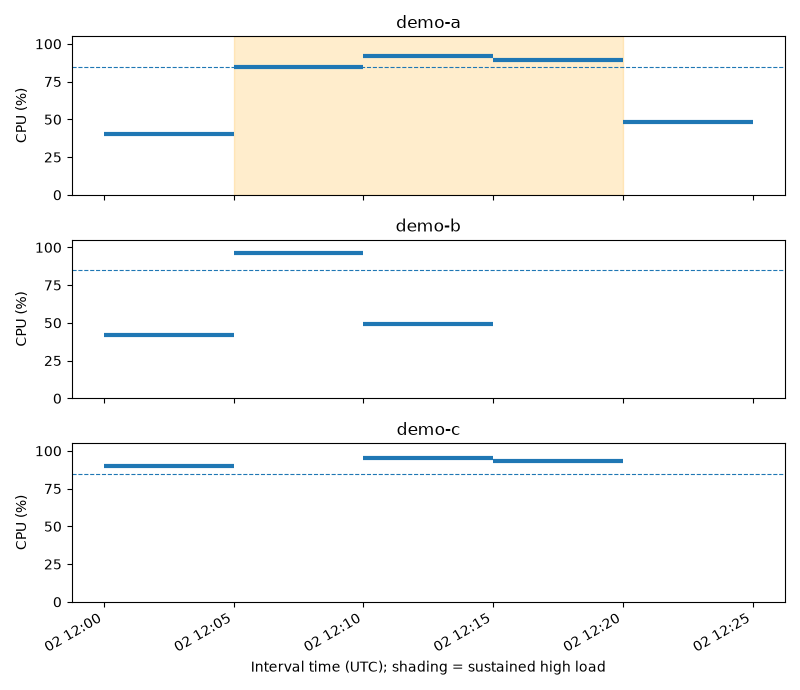

# OpsAI

**Data-center operations and capacity planning / 数据中心运维与容量规划**

OpsAI addresses two questions: Which servers need attention, and what evidence should an operator check next? A separate capacity tool estimates how much GPU hardware a facility's power budget can support.

OpsAI 帮助运维人员回答两个问题：哪些服务器需要关注？下一步应检查哪些证据？独立的容量工具则估算设施的功率预算能支持多少 GPU 设备。

## Project roadmap / 项目路线图

**Status / 当前进度（2026-11-09）：** The CPU rule and capacity tools run locally. A reproducible public demo of Project 1 is the target for the end of 2026. No operations dashboard or incident investigation service is deployed yet.

CPU 规则和容量工具已可本地运行。目标是在 2026 年底交付可公开演示、可复现的 Project 1。目前运维网页和事件调查服务均未部署。

### Project 1 — Server monitoring and explanation / 服务器监测与异常解释

Operators will import interval data, inspect a server's trend, review the evidence for a flag and export an investigation summary. Basic analysis must work without an AI key or model service.

运维人员将能导入采样数据、查看服务器趋势、核对触发告警的读数，并导出调查摘要。没有 AI 密钥或模型服务时，基础分析也应能够运行。

| Milestone / 阶段 | Status / 状态 | Deliverable and acceptance / 交付与验收 |
| --- | --- | --- |
| 1. CPU baseline / CPU 规则基线 | Local demo ready / 本地示例已完成 | Use known cases to distinguish sustained load from a brief spike or a gap in readings. / 用已知案例验证：只标出持续高负载，不把短暂尖峰或缺失区间误判为持续高负载。 |
| 2. Import and dashboard / 导入与网页 | Local CSV checks ready; UI planned / 已有本地 CSV 校验；网页待开发 | Load sample or user CSVs, check timestamps, units, missing and duplicate records, and show the server, interval, duration and readings behind each flag. Explain invalid inputs. / 支持示例和用户 CSV，检查时间、单位、缺失与重复记录；展示每次告警对应的服务器、时段、持续时间和读数，并说明输入错误。 |
| 3. AI explanation / AI 解释 | Planned / 计划中 | Compare rule-only and AI-assisted review on the same cases. Record correct server and time identification, unsupported claims, investigation time and failures. / 用同一组案例比较单用规则与加入 AI 解释的效果，记录定位是否正确、有无无依据说法、调查用时及失败案例。 |
| 4. Public demo / 公开演示 | Planned / 计划中 | Ship a demo URL, sample report, setup guide, screenshots, test and evaluation records, stable release and two-minute walkthrough. Another user should reproduce the result from the sample data. / 提供演示网址、示例报告、安装说明、截图、测试与评估记录、稳定版本和两分钟演示，让其他人能用示例数据复现结果。 |

The demo flags three consecutive five-minute intervals with mean CPU utilization ≥85%. This is a demonstration rule, not a fault diagnosis. Evaluate false alarms and missed events on representative operational data with known provenance and usage rights. Do not claim real-world detection accuracy without reliable labels.

演示规则要求连续三个五分钟区间的平均 CPU 使用率均达到 85%。被标记只表示值得调查。后续应使用来源及使用权限明确的运营数据评估误报和漏报；没有可靠标签时，不报告真实故障识别率。

[Proposal / 提案](project-1/proposal.md) · [Architecture / 架构图](docs/architecture.md) · [Data contract / 数据说明](docs/operational-data.md) · [Acceptance cases and task list / 验收案例与任务清单](eval/README.md)

### Project 2 — Incident investigation agent / 事件调查 Agent

The agent will use approved read-only tools to inspect metrics and incident records for a specified time window, retrieve documentation, and present evidence, plausible causes and next checks for operator review.

Agent 将使用获准的只读工具，查询指定时间段的指标和事件记录，检索技术文档，并向运维人员展示证据、可能原因和下一步检查建议。

| Planned milestone / 计划阶段 | Deliverable and acceptance / 交付与验收 |
| --- | --- |
| 1. Select an incident / 确定调查场景 | Keep Project 1 available. Review failures, technical debt and data gaps; select a scenario with accessible metrics, records and documentation, then complete the [proposal / 提案](project-2/proposal.md). / 保持 Project 1 可用，复盘失败案例、技术债和数据缺口，选择能取得指标、事件记录和文档的场景，完成提案。 |
| 2. Controlled investigation / 受控调查 | Define each tool's inputs, outputs, permissions and errors. Separate observations from hypotheses and recommendations; disclose failed queries, missing documents and conflicting evidence. / 明确每个工具的输入、输出、权限和错误处理；区分事实、推测和建议，说明查询失败、文档缺失或证据矛盾。 |
| 3. End-to-end demo / 端到端演示 | Publish a demo tracing one incident from input through tool calls and retrieved evidence to recommendations. Include automated tests, CI, deployment instructions and reproducible cases. / 发布公开演示，展示一次事件从输入、工具调用、证据检索到建议的全过程，提供自动测试、CI、部署说明和可复现案例。 |
| 4. Evaluation and release / 评估与发布 | Recheck both projects. Measure latency, estimated AI cost and failure rate; record retrieval errors, incorrect diagnoses and unsupported claims. Review secrets, input validation and permissions before release. / 复查两个项目，衡量响应时间、估算 AI 成本和失败率，记录检索错误、误诊和无依据结论；发布前检查密钥管理、输入校验与权限。 |

### Capacity module / 容量规划模块

Available now: deterministic power calculations, scenario comparison, PUE sensitivity, plots, a conversational CLI and local document retrieval. The 500 MW, PUE 1.2 baseline fits 221 whole pods, 7,072 racks and 226,304 GPUs under the documented power assumptions. This is a planning estimate, not a validated installation design.

现有功能包括功率计算、方案比较、PUE 敏感性分析、绘图、命令行对话和本地资料检索。在文档规定的功率假设下，500 MW、PUE 1.2 的基准结果为 221 个完整 Pod、7,072 个机架和 226,304 张 GPU。这是规划估算，尚未验证物理安装可行性。

A future dashboard page will call the same capacity tools and must reproduce the CLI results. High CPU load alone cannot establish GPU expansion needs. Power reserves, partial pods and rack constraints remain candidate extensions.

计划中的容量规划页面将调用同一套工具，并须复现 CLI 的结果。仅凭 CPU 高负载不能推断 GPU 扩容需求。功率预留、部分 Pod 分配和机架约束仍是后续候选功能。

## Quick start / 快速开始

Tested with Python 3.12. Run from the repository root in Windows PowerShell. Both local examples work without an API key.

已使用 Python 3.12 验证。在仓库根目录用 Windows PowerShell 运行以下命令；两个本地示例均无需 API 密钥。

```powershell
py -3.12 -m venv .venv
.\.venv\Scripts\python.exe -m pip install -r requirements-agent-lock.txt
.\.venv\Scripts\python.exe examples/cpu_baseline.py --plot generated/cpu_baseline.png
.\.venv\Scripts\python.exe examples/opsai_capacity.py
.\.venv\Scripts\python.exe -m unittest discover -s tests -v
```

On macOS or Linux, create the environment with `python3.12 -m venv .venv` and use `.venv/bin/python` for the remaining commands.

在 macOS 或 Linux 上，用 `python3.12 -m venv .venv` 创建环境，其余命令的解释器换成 `.venv/bin/python`。

The synthetic CPU example flags only **demo-a, 12:05–12:20 UTC**. Gaps indicate missing readings.

模拟 CPU 示例只标记 **demo-a 在 UTC 12:05–12:20 的时段**。图中空白表示缺少读数。



Optional: configure and start the conversational capacity CLI. Keep credentials in a local `.env` file and out of Git. See [CLI setup / 对话配置](docs/agent_cli.md).

可选：配置并启动容量规划命令行对话。密钥只保存在本地 `.env` 文件中，不要提交到 Git。

```powershell
.\.venv\Scripts\python.exe run_agent.py --configure
.\.venv\Scripts\python.exe run_agent.py
```

## Repository guide / 仓库导航

| Path / 路径 | Purpose / 用途 |
| --- | --- |
| `src/`, `agent/` | Capacity model, tool calls, LLM integration and retrieval / 容量模型、工具调用、模型接入与检索 |
| `data/`, `knowledge/` | Capacity scenarios, synthetic CPU readings and curated references; no live telemetry / 容量场景、模拟 CPU 读数和精选资料，无实时遥测 |
| `examples/`, `tests/`, `eval/` | Runnable examples, automated tests and evaluation criteria / 可运行示例、自动测试和评估标准 |
| `figures/`, `results/`, `notebooks/` | Capacity analysis figures, results and notebooks / 容量分析图表、结果与笔记本 |
| `app/` | Placeholders for planned application components / 待开发应用组件的目录占位 |
| `project-1/`, `project-2/` | Monitoring proposal and investigation project placeholder / 监测项目提案及事件调查项目占位 |
| `docs/`, `.github/workflows/` | Architecture, guides, provenance and automated checks / 架构、指南、来源记录和自动检查 |

[Source and migration checks / 来源与迁移验证](docs/source-provenance.md) · [Integration guide / 接入指南](docs/opsai-integration.md) · [Original capacity README / 原容量模块说明](CAPACITY_README.md)

The original capacity roadmap is historical; it does not define OpsAI release commitments. The owner has not selected an open-source license.

原容量模块的路线图仅作历史记录，不代表 OpsAI 的发布承诺。仓库所有者尚未选定开源许可证。
